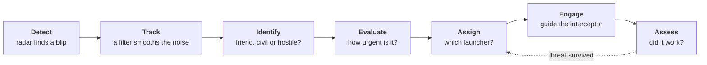

<div align="center">

<a href="https://mohammadalyounes.github.io/air-defense-sim/"></a>

# Air Defense Simulator

**See how an air-defense system thinks.**<br />
Drag a drone, missile or jet onto the map and watch a generic defense battery detect, track, identify, evaluate, engage and assess it, with the physics explained in plain language.

Created by **[Mohammad Alyounes](https://github.com/MohammadAlyounes)** · Built with [Claude Code](https://claude.com/claude-code)

[**Live demo**](https://mohammadalyounes.github.io/air-defense-sim/) · [**Run it locally**](#quick-start) · [**Follow the build**](#build-log) · [**Project plan**](docs/PROJECT_PLAN.md)

[](https://github.com/MohammadAlyounes/air-defense-sim/actions/workflows/ci.yml)


[](LICENSE)


</div>

> [!NOTE]
> **Educational and generic.** Every radar, launcher and interceptor in this project is fictional, with round-number parameters chosen for teaching. The physics is textbook-level and the terrain is procedurally generated. See [SAFETY.md](SAFETY.md).

## What you'll be able to do

- **Drag threats onto the map.** Small drones, drone swarms, cruise-missile-like targets and fast jets, plus friendly and civil aircraft that must _not_ be engaged.
- **Watch the whole defense loop.** A live analysis bar follows every track through **Detect → Track → Identify → Evaluate → Assign → Engage → Assess**, with a plain-language "Now" line.
- **Ask "Why?"** Click any decision to see the reasoning: the evidence, the threat score, the intercept geometry and the chance of a hit.
- **See the physics, not magic.** Radar horizon, terrain masking, Kalman filtering and proportional navigation, each explained in three sentences and one formula.
- **Experiment.** Tune parameters, save and share scenarios, rewind and try a different decision, or run a scenario hundreds of times to see the odds.

## Quick start

You need [Node.js 22 or newer](https://nodejs.org/).

```bash
git clone https://github.com/MohammadAlyounes/air-defense-sim.git
cd air-defense-sim
npm install
npm run dev
```

Then open http://localhost:5173 in your browser.

Nothing to install? Run it in the cloud with one click:

[](https://codespaces.new/MohammadAlyounes/air-defense-sim)

## How it works: the defense loop



| Stage        | In one sentence                                                                                       |
| ------------ | ----------------------------------------------------------------------------------------------------- |
| **Detect**   | The search radar scans the sky; any echo strong enough to stand out from the noise becomes a blip.    |
| **Track**    | Blips from successive scans are linked into a track, and a filter estimates position and velocity.    |
| **Identify** | Speed and altitude suggest the type; an identification check separates friend, civil and hostile.     |
| **Evaluate** | Threats are ranked by how soon, and how close, they will reach a defended asset.                      |
| **Assign**   | The system checks range, free radar channels and ammunition, then picks a launcher.                   |
| **Engage**   | The interceptor flies toward a predicted intercept point, then homes in with proportional navigation. |
| **Assess**   | The radar watches what happens next; if the threat survived, the loop goes again.                     |

## The physics, in plain language

Every step adds short concept cards: the idea in three sentences, one formula, one worked example, and where to see it in the simulator. The same cards open inside the app from the graduation-cap buttons.

<!-- concepts:start -->
<!-- Generated from docs/concepts by `npm run docs:sync`. Edit the cards there. -->

### Fixed time step — why every run can be replayed exactly

The simulation advances in identical 20 ms ticks (50 per second), no matter how fast your screen redraws. Each tick runs the same equations with the same seeded random numbers, so the same seed and the same inputs always reproduce exactly the same run. That is what makes pausing, single-stepping, replays and fair comparisons possible.

- **Formula:** `position(t + Δt) = position(t) + velocity × Δt`, with `Δt = 1/50 s`
- **Example:** a small drone flying at 40 m/s moves exactly 0.8 m per tick, whether you watch at ¼× or at 16×.
- **See it:** pause, then press Step: the clock moves by one 20 ms tick. Press Restart and the same blips reappear at the same moments.

[Going deeper →](docs/concepts/01-1-fixed-time-step.md)

### Antenna rotation — why blips jump instead of gliding

A search radar's antenna spins, so it sees each aircraft only when its beam sweeps past. Between passes the screen keeps showing the last echo, slowly fading like the phosphor of an old radar tube. A faster spin refreshes the picture more often, but leaves the beam less time on each target.

- **Formula:** `refresh interval = 360° ÷ rotation rate` (here, one turn every 4 s)
- **Example:** a fast jet at 340 m/s moves 1.36 km between two passes of the beam.
- **See it:** watch a fast-moving blip on the radar scope: each new echo lands a short jump ahead of the last one.

[Going deeper →](docs/concepts/01-2-antenna-rotation.md)

### Local coordinates — one map for the radar, the scope and the 3D view

Every position is measured in metres from the battery: east (x), north (y) and up (z). The radar measures a bearing and a range, which the simulator turns into these flat local coordinates, accurate enough over a 40 km area. The 3D view draws the very same numbers, only turned so that "up" points up on your screen.

- **Formula:** `east = range × sin(bearing)`, `north = range × cos(bearing)`
- **Example:** an echo at bearing 090° and 20 km sits at east = 20 km, north = 0.
- **See it:** click an echo on the radar scope: the 3D view highlights the same aircraft, in the same place.

[Going deeper →](docs/concepts/02-1-local-coordinates.md)

### Seeing scale — why heights are stretched and aircraft enlarged

At true scale the battlespace is a thin sheet, 80 km across but only 11 km tall at an airliner's cruising height, and a 2 m drone 30 km away would be a twentieth of a pixel. So the 3D view stretches heights (×2 by default) and draws each aircraft at a fixed size on screen, however far away it is. Labels always show the true altitude.

- **Formula:** `drawn height = true height × stretch`
- **Example:** a cruise-missile-like target flying 50 m above the ground is drawn 100 m up at ×2, and 200 m up at ×4.
- **See it:** switch the 3D view's Heights control between ×1, ×2 and ×4 and watch the drop lines grow.

[Going deeper →](docs/concepts/02-2-seeing-scale.md)

<!-- concepts:end -->

**Coming next:** detection range and proportional navigation (Step 3) · air density, drag and turn radius (Step 4) · the radar equation, the radar horizon and terrain masking (Step 5).

## Build log

Every step is a git tag and a [GitHub Release](https://github.com/MohammadAlyounes/air-defense-sim/releases), so you can check out any stage of the project, for example `git checkout step-02-3d-scene`. Newest step first.

### Step 2 · 3D scene

<p align="center"></p>

The battlespace in 3D, in step with the radar scope: select an aircraft in one view and every view follows.

- **3D battlespace:** ground grid, range rings every 10 km, and the radar site with its turning antenna, search beam and sweep, all driven by the same simulation as the scope.
- **Aircraft:** models built from the palette silhouettes, each with a drop line to the ground, a fading 30-second trail and a tag showing its true altitude.
- **Cameras:** Orbit, Top (north up, like the scope), Follow and Radar (stand at the antenna and look out), on keys 1–4. Stretch heights ×1, ×2 or ×4; toggle labels with L.
- **One selection everywhere:** click an aircraft in 3D, an echo on the scope or a line in the event log. The scope boxes its echo, and the inspector shows the ground truth: speed, altitude, heading, range and what the radar knows. Esc clears it.
- **Shareable views:** [`?t=60&select=3&camera=follow`](https://mohammadalyounes.github.io/air-defense-sim/?t=60&select=3&camera=follow) opens the run one minute in, following the fast jet.

> **Engineering note: one truth, many views.** The scope, the 3D view and the inspector all read the same pair of simulation snapshots, so they can never disagree. The 3D view only draws when something changes (a paused run costs no GPU time), and three.js loads in its own chunk after the console is on screen.


<details>
<summary>Phone layout</summary>
<br />

</details>

### Step 1 · Simulation core

<p align="center"></p>

The simulator comes alive: a deterministic engine running at 50 ticks per second, a live radar scope, and controls to play, pause, step and replay.

- **Simulation engine (`src/sim`):** pure TypeScript with a fixed 20 ms time step, a seeded random-number generator, scenario traffic that crosses the area, and a search radar whose rotating beam paints each aircraft as it sweeps past.
- **Live radar scope:** a sweeping beam and echoes that fade like old phosphor; bigger aircraft return bigger blips.
- **Player bar:** play/pause (Space), step one tick (.) or one second (Shift + .), speed from ¼× to 16× (+ / −), the seed, Restart (R) and New seed.
- **Live header:** the Detect stage counts radar contacts and the NOW line describes the radar picture in plain words. Stages that arrive later say which step brings them.
- **Event log:** SCENARIO lines (what really happens) next to RADAR lines (what the radar actually sees).
- **Concept cards in the app:** the graduation-cap buttons open the same cards as this README.

> **Engineering note: replay by construction.** A run is fully defined by its seed and the commands sent to it, each stamped with its tick. Unit tests rebuild runs from their command logs and compare state hashes; a browser test restarts the same seed and checks the event log matches line for line. Any moment is a link: [`?seed=7&t=60`](https://mohammadalyounes.github.io/air-defense-sim/?seed=7&t=60) opens seed 7, one minute in.


<details>
<summary>Phone layout</summary>
<br />

</details>

### Step 0 · Launchpad


The foundation everything else builds on.

- **Console shell:** the header analysis bar (seven-stage pipeline, key numbers, plain-language "Now" line), the threat palette, an animated radar scope, and a panel for every future feature, each labelled with the step that brings it to life.
- **Tooling:** strict TypeScript, Vite 8, React 19, Tailwind CSS 4, ESLint, Prettier, Vitest and Playwright.
- **CI/CD:** every push is linted, type-checked, tested in a real browser and deployed to GitHub Pages.

> **Engineering note: determinism, enforced from day one.** The simulation core (`src/sim`) is not allowed to call `Math.random()`, read the wall clock or touch browser APIs, and the linter rejects any attempt. Same inputs, same outputs, every time: that is what will make exact replays, "rewind and try again" and Monte Carlo runs possible.

<details>
<summary>Phone layout</summary>
<br />

</details>

## Roadmap

- [x] **Step 0 · Launchpad:** project scaffold, CI, live demo and the console shell
- [x] **Step 1 · Simulation core:** deterministic clock, play/pause/step/speed, live radar scope
- [x] **Step 2 · 3D scene:** 3D ground, models, trails, labels and cameras
- [ ] **Step 3 · First intercept:** the first full loop, drag-and-drop threats and the live analysis bar
- [ ] **Step 4 · Environment:** terrain, atmosphere, wind and drag; three threat types with routes
- [ ] **Step 5 · Radar realism:** radar equation, noise, horizon, terrain masking, clutter and coverage maps
- [ ] **Step 6 · Tracking:** Kalman tracking, uncertainty ellipses, track table, truth vs. perception
- [ ] **Step 7 · Identify & evaluate:** identification, friendly and civil traffic, threat ranking with "Why?"
- [ ] **Step 8 · Engage:** engagement envelopes, kill probability, doctrine and missile phases
- [ ] **Step 9 · Assess:** kill assessment and re-engagement; full analysis bar, log, telemetry, inspector
- [ ] **Step 10 · Scenarios:** save, load and share; editor and raid generator
- [ ] **Step 11 · Learning layer:** ten guided lessons, live equations, challenges, after-action review
- [ ] **Step 12 · Replay & analysis:** timeline scrubbing, rewind and branch, Monte Carlo, CSV export
- [ ] **Step 13 · Polish:** cinematic intro, effects, sound, themes, accessibility
- [ ] **Step 14 · Release v1.0:** demo video, final README and launch kit

The full specification is in [docs/PROJECT_PLAN.md](docs/PROJECT_PLAN.md).

## Under the hood

| Layer      | Choice                                                                 |
| ---------- | ---------------------------------------------------------------------- |
| Language   | TypeScript (strict)                                                    |
| App        | React 19, Vite 8                                                       |
| 3D         | Three.js with React Three Fiber, loaded on demand                      |
| Styling    | Tailwind CSS 4, Radix UI, Lucide icons                                 |
| Simulation | Plain TypeScript: fixed time step, seeded randomness, Web Worker ready |
| App state  | Zustand                                                                |
| Tests      | Vitest (unit), Playwright (browser)                                    |
| CI/CD      | GitHub Actions → GitHub Pages                                          |

```
src/
  sim/      The engine: pure, deterministic TypeScript (clock, random numbers, traffic, radar)
  app/      React UI: analysis bar, palette, radar scope, 3D view, panels and the simulation driver
e2e/        Browser tests
docs/       Plan, architecture, models, devlog, concept cards and media
scripts/    Docs sync, screenshots, GIFs and preview images
```

| Command             | What it does                                            |
| ------------------- | ------------------------------------------------------- |
| `npm run dev`       | Start the dev server                                    |
| `npm run build`     | Production build into `dist/`                           |
| `npm test`          | Unit tests                                              |
| `npm run test:e2e`  | Browser tests                                           |
| `npm run check`     | Lint, type-check, unit tests, format and docs checks    |
| `npm run docs:sync` | Copy the concept cards from `docs/concepts` into README |

More detail in [docs/ARCHITECTURE.md](docs/ARCHITECTURE.md) (how it fits together) and [docs/MODELS.md](docs/MODELS.md) (every equation and its limits).

## Safety and scope

This is a learning tool, not a model of any real system. Equipment and terrain are fictional, parameters are illustrative, and the physics stays at textbook level. Community scenarios must follow the same rules: read [SAFETY.md](SAFETY.md).

## Built with Claude

This project is being built in public, step by step, with [Claude Code](https://claude.com/claude-code). The rules Claude follows in this repository are in [CLAUDE.md](CLAUDE.md), and every step's decisions are logged in [docs/DEVLOG.md](docs/DEVLOG.md).

Created by [Mohammad Alyounes](https://github.com/MohammadAlyounes). Contributions are welcome: see [CONTRIBUTING.md](CONTRIBUTING.md).

## License

Code: [MIT](LICENSE). Documentation, lessons and concept cards: [CC BY 4.0](LICENSE-docs.md).

If you share, fork or build on this project, please keep the credit "Created by Mohammad Alyounes" (see [NOTICE](NOTICE)). To cite it, use the **Cite this repository** button on GitHub ([CITATION.cff](CITATION.cff)).
