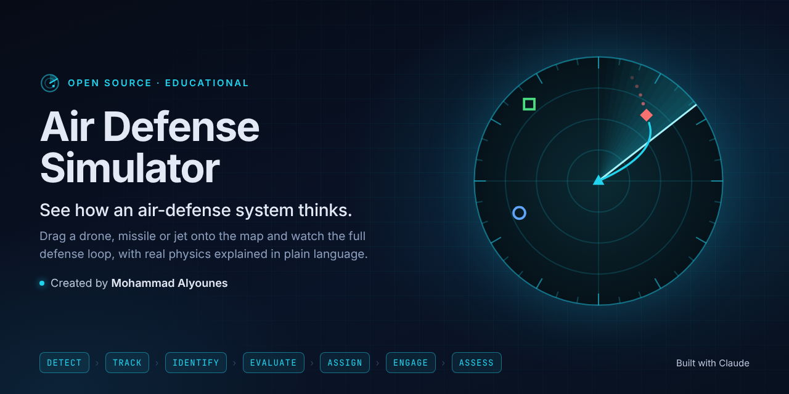
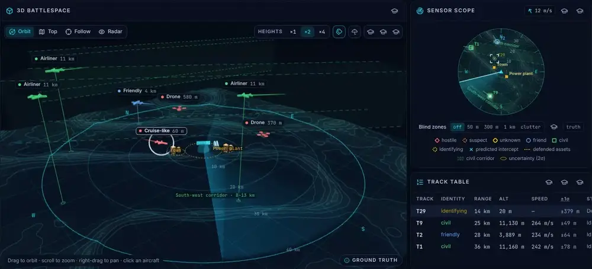
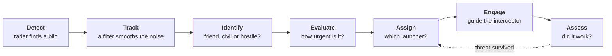

<div align="center">

<a href="https://mohammadalyounes.github.io/air-defense-sim/"></a>

# Air Defense Simulator

**See how an air-defense system thinks.**<br />
Drag a drone, missile or jet onto the map and watch a generic defense battery detect, track, identify, evaluate, engage and assess it, with the physics explained in plain language.

Created by **[Mohammad Alyounes](https://github.com/MohammadAlyounes)** · Built with [Claude Code](https://claude.com/claude-code)

[**Live demo**](https://mohammadalyounes.github.io/air-defense-sim/) · [**Run it locally**](#quick-start) · [**Build log**](#build-log) · [**The physics**](docs/PHYSICS.md)

[](https://github.com/MohammadAlyounes/air-defense-sim/actions/workflows/ci.yml)

[](https://github.com/MohammadAlyounes/air-defense-sim/releases/tag/v1.0.0)
[](LICENSE)


</div>

> [!NOTE]
> **Educational and generic.** Every radar, launcher and interceptor in this project is fictional, with round-number parameters chosen for teaching. The physics is textbook-level and the terrain is procedurally generated. See [SAFETY.md](SAFETY.md).

## What you can do

- **Drag threats onto the map.** Small drones, drone swarms, cruise-missile-like targets and fast jets, plus friendly and civil aircraft that must _not_ be engaged.
- **Watch the whole defense loop.** A live analysis bar follows every track through **Detect → Track → Identify → Evaluate → Assign → Engage → Assess**, with a plain-language "Now" line.
- **Ask "Why?"** Click any decision to see the reasoning: the evidence, the threat score, the intercept geometry and the chance of a hit.
- **See the physics, not magic.** Radar horizon, terrain masking, clutter and Doppler, wind, turn radius, air drag, Kalman filtering and proportional navigation, each explained in two sentences and one formula.
- **Make the calls.** Switch weapons control between TIGHT, FREE and HOLD, approve or hold every shot yourself in SEMI-AUTO, and see what a mistake costs.
- **Compare perception with the truth.** Show where the aircraft really are next to what the radar believes, switch on the coverage maps, or restart any run from its seed and watch it play out exactly the same way.

<p align="center"></p>

## Quick start

You need [Node.js 22 or newer](https://nodejs.org/).

```bash
git clone https://github.com/MohammadAlyounes/air-defense-sim.git
cd air-defense-sim
npm install
npm run dev
```

Then open http://localhost:5173 in your browser.

Nothing to install? Run it in the cloud with one click:

[](https://codespaces.new/MohammadAlyounes/air-defense-sim)

## How it works: the defense loop



## The physics, in plain language

Every model has a short card: the idea in two sentences, one formula, one example and where to see it in the simulator. The same cards open in the app from the graduation-cap buttons. Read them all in **[docs/PHYSICS.md](docs/PHYSICS.md)**:

- **Time and space:** fixed time step · antenna rotation · local coordinates · seeing scale
- **Radar:** detection range · radar horizon · terrain masking · detection probability · clutter and Doppler
- **Air and flight:** air drag · wind · turn radius
- **Tracking and identification:** Kalman filter · gating and association · identification friend-or-foe
- **Engagement:** closest point of approach · engagement envelope · proportional navigation · kill probability · rules of engagement

## Build log

The simulator is complete at **version 1.0.0**. It was built in six steps, each a git tag and a GitHub Release with a screenshot of that stage, so you can check out any of them (`git checkout step-03-first-intercept`). The decisions behind each step are in [docs/DEVLOG.md](docs/DEVLOG.md).

| Step                          | What it added                                                                                                             |
| ----------------------------- | ------------------------------------------------------------------------------------------------------------------------- |
| [5 · Track & identify][s5]    | Kalman tracking, identification and civil corridors, threat ranking with "Why?", rules of engagement and kill probability |
| [4 · Environment & radar][s4] | Terrain, atmosphere and wind, threat routes; radar horizon, masking, noise, clutter and coverage maps                     |
| [3 · First intercept][s3]     | The first full loop, drag-and-drop threats and the live analysis bar                                                      |
| [2 · 3D scene][s2]            | 3D battlespace, cameras, trails and one selection across every view                                                       |
| [1 · Simulation core][s1]     | Deterministic 50 Hz engine, live radar scope and replayable runs                                                          |
| [0 · Launchpad][s0]           | Tooling, CI, live demo and the console shell                                                                              |

[s5]: https://github.com/MohammadAlyounes/air-defense-sim/releases/tag/step-05-track-identify
[s4]: https://github.com/MohammadAlyounes/air-defense-sim/releases/tag/step-04-environment-radar
[s3]: https://github.com/MohammadAlyounes/air-defense-sim/releases/tag/step-03-first-intercept
[s2]: https://github.com/MohammadAlyounes/air-defense-sim/releases/tag/step-02-3d-scene
[s1]: https://github.com/MohammadAlyounes/air-defense-sim/releases/tag/step-01-sim-core
[s0]: https://github.com/MohammadAlyounes/air-defense-sim/releases/tag/step-00-launchpad

## Documentation

| File                               | What is in it                                                      |
| ---------------------------------- | ------------------------------------------------------------------ |
| [docs/PHYSICS.md](docs/PHYSICS.md) | The concept cards, the key numbers of every model and their limits |
| [docs/DESIGN.md](docs/DESIGN.md)   | Goals, the console, the architecture and where the code lives      |
| [docs/DEVLOG.md](docs/DEVLOG.md)   | What each release added and why                                    |
| [SAFETY.md](SAFETY.md)             | The safety rules every contribution follows                        |
| [CLAUDE.md](CLAUDE.md)             | The working rules for Claude Code and contributors                 |

## Contributing

Fixes, clearer explanations and better tests are welcome. Before you open a pull request:

```bash
npm run check      # lint, type-check, unit tests and format check
npm run test:e2e   # browser tests
```

Keep `src/sim` pure (no UI imports, browser APIs, `Math.random()` or wall-clock time), give new physics a concept card in [docs/PHYSICS.md](docs/PHYSICS.md) and unit tests against known values, and follow [SAFETY.md](SAFETY.md).

## License

Code: [MIT](LICENSE). Documentation and concept cards: [CC BY 4.0](https://creativecommons.org/licenses/by/4.0/) (see [NOTICE](NOTICE)).

Created by [Mohammad Alyounes](https://github.com/MohammadAlyounes) and built with [Claude Code](https://claude.com/claude-code). If you share, fork or build on this project, please keep the credit "Created by Mohammad Alyounes" (see [NOTICE](NOTICE)). To cite it, use the **Cite this repository** button on GitHub ([CITATION.cff](CITATION.cff)).
