<div align="center">

<a href="https://mohammadalyounes.github.io/air-defense-sim/"></a>

# Air Defense Simulator

**See how an air-defense system thinks.**<br />
Drag a drone, missile or jet onto the map and watch a generic defense battery detect, track, identify, evaluate, engage and assess it, with the physics explained in plain language.

Created by **[Mohammad Alyounes](https://github.com/MohammadAlyounes)** · Built with [Claude Code](https://claude.com/claude-code)

[**Live demo**](https://mohammadalyounes.github.io/air-defense-sim/) · [**Run it locally**](#quick-start) · [**Follow the build**](#build-log) · [**Project plan**](docs/PROJECT_PLAN.md)

[](https://github.com/MohammadAlyounes/air-defense-sim/actions/workflows/ci.yml)


[](LICENSE)


</div>

> [!NOTE]
> **Educational and generic.** Every radar, launcher and interceptor in this project is fictional, with round-number parameters chosen for teaching. The physics is textbook-level and the terrain is procedurally generated. See [SAFETY.md](SAFETY.md).

## What you'll be able to do

- **Drag threats onto the map.** Small drones, drone swarms, cruise-missile-like targets and fast jets, plus friendly and civil aircraft that must _not_ be engaged.
- **Watch the whole defense loop.** A live analysis bar follows every track through **Detect → Track → Identify → Evaluate → Assign → Engage → Assess**, with a plain-language "Now" line.
- **Ask "Why?"** Click any decision to see the reasoning: the evidence, the threat score, the intercept geometry and the chance of a hit.
- **See the physics, not magic.** Radar horizon, terrain masking, detection probability, air drag, Kalman filtering and proportional navigation, each explained in three sentences and one formula.
- **Experiment.** Tune parameters, save and share scenarios, rewind and try a different decision, or run a scenario hundreds of times to see the odds.

## Quick start

You need [Node.js 22 or newer](https://nodejs.org/).

```bash
git clone https://github.com/MohammadAlyounes/air-defense-sim.git
cd air-defense-sim
npm install
npm run dev
```

Then open http://localhost:5173 in your browser.

Nothing to install? Run it in the cloud with one click:

[](https://codespaces.new/MohammadAlyounes/air-defense-sim)

## How it works: the defense loop

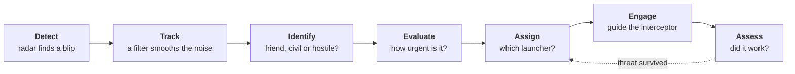

| Stage        | In one sentence                                                                                       |
| ------------ | ----------------------------------------------------------------------------------------------------- |
| **Detect**   | The search radar scans the sky; any echo strong enough to stand out from the noise becomes a blip.    |
| **Track**    | Blips from successive scans are linked into a track, and a filter estimates position and velocity.    |
| **Identify** | Speed and altitude suggest the type; an identification check separates friend, civil and hostile.     |
| **Evaluate** | Threats are ranked by how soon, and how close, they will reach a defended asset.                      |
| **Assign**   | The system checks range, free radar channels and ammunition, then picks a launcher.                   |
| **Engage**   | The interceptor flies toward a predicted intercept point, then homes in with proportional navigation. |
| **Assess**   | The radar watches what happens next; if the threat survived, the loop goes again.                     |

## The physics, in plain language

Every step adds short concept cards: the idea in three sentences, one formula, one worked example, and where to see it in the simulator. The same cards open inside the app from the graduation-cap buttons.

<!-- concepts:start -->
<!-- Generated from docs/concepts by `npm run docs:sync`. Edit the cards there. -->

### Fixed time step — why every run can be replayed exactly

The simulation advances in identical 20 ms ticks (50 per second), no matter how fast your screen redraws. Each tick runs the same equations with the same seeded random numbers, so the same seed and the same inputs always reproduce exactly the same run. That is what makes pausing, single-stepping, replays and fair comparisons possible.

- **Formula:** `position(t + Δt) = position(t) + velocity × Δt`, with `Δt = 1/50 s`
- **Example:** a small drone flying at 40 m/s moves exactly 0.8 m per tick, whether you watch at ¼× or at 16×.
- **See it:** pause, then press Step: the clock moves by one 20 ms tick. Press Restart and the same blips reappear at the same moments.

[Going deeper →](docs/concepts/01-1-fixed-time-step.md)

### Antenna rotation — why blips jump instead of gliding

A search radar's antenna spins, so it sees each aircraft only when its beam sweeps past. Between passes the screen keeps showing the last echo, slowly fading like the phosphor of an old radar tube. A faster spin refreshes the picture more often, but leaves the beam less time on each target.

- **Formula:** `refresh interval = 360° ÷ rotation rate` (here, one turn every 4 s)
- **Example:** a fast jet at 340 m/s moves 1.36 km between two passes of the beam.
- **See it:** watch a fast-moving blip on the radar scope: each new echo lands a short jump ahead of the last one.

[Going deeper →](docs/concepts/01-2-antenna-rotation.md)

### Local coordinates — one map for the radar, the scope and the 3D view

Every position is measured in metres from the battery: east (x), north (y) and up (z). The radar measures a bearing and a range, which the simulator turns into these flat local coordinates, accurate enough over a 40 km area. The 3D view draws the very same numbers, only turned so that "up" points up on your screen.

- **Formula:** `east = range × sin(bearing)`, `north = range × cos(bearing)`
- **Example:** an echo at bearing 090° and 20 km sits at east = 20 km, north = 0.
- **See it:** click an echo on the radar scope: the 3D view highlights the same aircraft, in the same place.

[Going deeper →](docs/concepts/02-1-local-coordinates.md)

### Seeing scale — why heights are stretched and aircraft enlarged

At true scale the battlespace is a thin sheet, 80 km across but only 11 km tall at an airliner's cruising height, and a 2 m drone 30 km away would be a twentieth of a pixel. So the 3D view stretches heights (×2 by default) and draws each aircraft at a fixed size on screen, however far away it is. Labels always show the true altitude.

- **Formula:** `drawn height = true height × stretch`
- **Example:** a cruise-missile-like target flying 50 m above the ground is drawn 100 m up at ×2, and 200 m up at ×4.
- **See it:** switch the 3D view's Heights control between ×1, ×2 and ×4 and watch the drop lines grow.

[Going deeper →](docs/concepts/02-2-seeing-scale.md)

### Detection range — why small drones are seen late

A radar sees an object by the echo it sends back, and that echo weakens very fast with distance: twice as far gives one sixteenth of the signal. So the range at which an object is first detected grows only with the fourth root of its radar cross section, which is how big it looks to radar. An object with a hundredth of the cross section is seen at about a third of the range.

- **Formula:** `R_detect = R_ref × (σ / 1 m²)^(1/4)`, with `R_ref = 30 km` here
- **Example:** a small drone (σ = 0.01 m²) is first seen at 30 × 0.01^¼ ≈ 9.5 km; a fast jet (2 m²) at about 36 km.
- **See it:** drag a drone onto the map: the readout says the radar sees it from 9.5 km, and the scope stays empty until it gets there.

[Going deeper →](docs/concepts/03-1-detection-range.md)

### Proportional navigation — why the interceptor leads its target

An interceptor that always points at its target ends up in a long tail chase. Instead, it watches the line of sight to the target and turns just enough to stop that line from rotating: if the line of sight holds still while the distance shrinks, the two are on a collision course. Sailors use the same rule to spot a collision: constant bearing, decreasing range.

- **Formula:** `a = N × Vc × λ̇` (sideways acceleration = navigation constant × closing speed × line-of-sight turn rate), with `N = 4`
- **Example:** closing at 500 m/s while the line of sight turns at 0.02 rad/s, the interceptor steers at 4 × 500 × 0.02 = 40 m/s², about 4 g.
- **See it:** watch an interceptor on the scope or in the 3D view: it flies toward the cyan cross (the predicted intercept point), not toward where the target is now.

[Going deeper →](docs/concepts/03-2-proportional-navigation.md)

### Radar horizon — why the Earth's curve hides low flyers

Radar waves travel in almost straight lines, but the Earth curves away beneath them, so far enough out even open ground hides a low target. The air bends radio waves slightly back down, which the textbook "4/3 Earth" model handles by drawing the Earth a third larger than it is. The higher the antenna and the higher the target, the farther the horizon.

- **Formula:** `d ≈ 4.12 km × (√h_radar + √h_target)`, heights in metres
- **Example:** with the 12 m antenna, a target at 50 m is below the horizon beyond 4.12 × (3.5 + 7.1) ≈ 43 km; a jet at 6,000 m stays in view out to 330 km.
- **See it:** select a low aircraft far out: the inspector's "Radar view" row says when it is below the horizon.

[Going deeper →](docs/concepts/04-1-radar-horizon.md)

### Terrain masking — why hills hide what flies low behind them

A hill casts a "radar shadow", much like a shadow from a lamp at the radar's antenna. A target flying low behind the hill sits inside that shadow and cannot be seen, however strong the radar. The shadow is deeper the taller the hill, the closer it stands to the radar, and the farther the target is behind it.

- **Formula:** behind a hill of height `H` at distance `d₁`, a target at distance `d₂` is seen only above `h ≈ H × d₂ / d₁` (antenna near the ground)
- **Example:** a 400 m ridge 10 km out hides everything below about 1,200 m at 30 km, so a target flying 50 m above the ground stays hidden until it crosses the ridge.
- **See it:** switch on "Blind zones" under the scope: orange shows where the radar cannot see a target at 50 m, 300 m or 1 km above the ground.

[Going deeper →](docs/concepts/04-2-terrain-masking.md)

### Detection probability — why the radar sometimes misses, and sometimes sees ghosts

A radar decides "target or not" by checking whether the echo rises above a threshold set over the receiver's noise. A real target's echo flickers from scan to scan as it turns, so near its maximum range it is only seen on some looks. Set the threshold lower and you see more, but random noise also crosses it more often: those are false alarms.

- **Formula:** `Pd = Pfa^(1 / (1 + SNR))` for a flickering (Swerling 1) target, with `SNR ∝ σ / R⁴`
- **Example:** with a false-alarm chance Pfa = 10⁻⁶ per cell, a drone at its 9.5 km "50% range" is seen on half the looks, and on 85% of them at 6.6 km. Over 600,000 cells per turn, about 0.6 false alarms appear each turn.
- **See it:** watch for lone blips that appear once and vanish: the log calls them "dropped", because a second echo never came to confirm them.

[Going deeper →](docs/concepts/04-3-detection-probability.md)

### Air drag — why an interceptor's reach depends on altitude

Once its motor burns out, an interceptor coasts and the air slows it down. Drag grows with the square of speed and with air density, and the air thins out with height, halving about every 6 km. So the same interceptor reaches farther, and arrives faster, against a high target than against a low one.

- **Formula:** `a_drag = ρ(h) · v² / (2β)`, with `ρ(h) = 1.225 kg/m³ × e^(−h / 8.5 km)` and ballistic coefficient `β = 20,000 kg/m²`
- **Example:** at sea level and 760 m/s, drag slows it by 17.7 m/s² (almost 2 g); after 10 s of coasting it is down to 617 m/s and has flown 6.8 km instead of 7.6 km.
- **See it:** drop a fast jet high and a cruise-missile-like target low at the same distance: the low one is intercepted closer in, after a slower flight.

[Going deeper →](docs/concepts/04-4-air-drag.md)

### Kalman filter — how the tracker sees through the noise

Every radar echo is a little off, so joining the raw blips would give a jittery track and a wild velocity. A Kalman filter keeps a best guess of position and velocity, together with how unsure it is, and moves the guess forward between echoes. When a new echo arrives, it blends the guess and the echo in proportion to how much it trusts each.

- **Formula:** `x̂ ← x̂⁻ + K · (z − x̂⁻)`, with the gain `K = P⁻ / (P⁻ + R)` (in one dimension: P⁻ is the prediction's variance, R the echo's)
- **Example:** a prediction good to ±80 m and an echo good to ±80 m give K = 0.5: the new estimate lies halfway, good to ±57 m (80 / √2). After a dozen echoes a jet's speed is known to within a few m/s, where two raw echoes 4 s apart could be 30 m/s off.
- **See it:** the faint ellipse around each track on the scope is its 2σ uncertainty, and the track table's ±1σ column shrinks as echoes come in. Press T to compare tracks with the truth.

[Going deeper →](docs/concepts/05-1-kalman-filter.md)

### Gating and association — which echo belongs to which track

With several targets, false alarms and noise, the tracker must decide which new echo continues which track, without knowing what made it. It draws a "gate" around each track's predicted position, sized by its uncertainty, and only echoes inside the gate are candidates. The closest pairs, measured in standard deviations, are matched first; leftover echoes start new tentative tracks.

- **Formula:** `d² = νᵀ · S⁻¹ · ν < 16.3`, where ν is the gap between the echo and the prediction and S its expected spread (the 99.9% limit for three dimensions)
- **Example:** a track predicted to ±100 m: an echo 250 m off is 2.5 standard deviations (d² = 6.3) and joins it; one 500 m off is 5 standard deviations (d² = 25) and starts a new track instead.
- **See it:** drop a drone swarm: six echoes close together. Watch the tracks settle into one per drone after a few sweeps, and press T to see which track follows which drone.

[Going deeper →](docs/concepts/05-2-gating-association.md)

<!-- concepts:end -->

**Coming next:** wind, turn radius, the radar equation and RCS, clutter and Doppler (Step 4) · identification friend-or-foe and the closest point of approach (Step 5) · kill probability and saturation (Step 6).

## Build log

Every step is a git tag and a [GitHub Release](https://github.com/MohammadAlyounes/air-defense-sim/releases), so you can check out any stage of the project, for example `git checkout step-03-first-intercept`. Newest step first.

### Step 5 · Track & identify (part 1: tracking)

The battery's picture of the sky becomes a real estimate, with an honest measure of how sure it is.

- **Kalman filter:** every track blends its prediction with each new echo, weighted by how much it trusts each. Positions jitter less than the raw echoes and velocities settle within a few m/s.
- **Association without the truth:** echoes join tracks by gating and global nearest neighbour, matched in 0.2 s batches so close neighbours like a drone swarm compete fairly. The tracker never knows which aircraft made an echo.
- **Uncertainty you can see:** a faint 2σ ellipse around each track on the scope, stretched sideways far out where bearing errors dominate, and a ±1σ column in the track table.
- **Truth vs. perception:** press T (or "truth" under the scope) to see where aircraft really are: grey crosses and error lines on the scope, the battery's tracks as rings next to the real aircraft in 3D, and the tracking error in the inspector.

> **Engineering note: a filter that checks its own honesty.** The unit tests feed the filter noisy measurements and check that its normalized innovation averages 3, the value a chi-square law with three degrees of freedom predicts. A filter that claimed to be surer than it is would fail.

_Screenshots and a clip for this step come with the v1.0 media pass._

### Step 4 · Environment & radar (part 1: terrain and radar)

The battlespace gets a landscape, and the radar becomes honest about what it can and cannot see.

- **Procedural terrain:** fictional hills and ridges around a flat valley, generated from a seed, in 3D (with relief shading and contour lines) and as a faint relief on the scope. Drones and cruise-missile-like targets follow the ground; jets climb over it.
- **Radar horizon and terrain masking:** the radar sees only along clear lines of sight over the curved Earth. Low flyers hide behind the ridges to the south and west until they are 7 to 10 km out.
- **Blind zones:** one switch under the scope shades, on the scope and on the 3D terrain, where the radar cannot see a target at 50 m, 300 m or 1 km above the ground.
- **Detection probability, noise and false alarms:** echoes flicker near the edge of range, every measurement is a little off, and noise sometimes makes a ghost blip. A single echo never becomes a track on its own, so ghosts are dropped and never engaged.
- **Air drag:** interceptors slow down as they coast, more in the thick air near the ground, and the command node plans with it.
- **Readouts that explain:** the placement card warns when the terrain will hide a threat, and the inspector says whether the radar can see the selected aircraft, and why not.

> **Engineering note: one terrain, many readers.** The landscape is generated once from its own seed and shared by the simulation, the scope, the 3D mesh and the placement readout, so the blind zones you see are exactly the ones the radar uses. A radial sweep builds the whole coverage map in a few milliseconds.

_Screenshots and a clip for this step come with the v1.0 media pass._

### Step 3 · First intercept

<p align="center">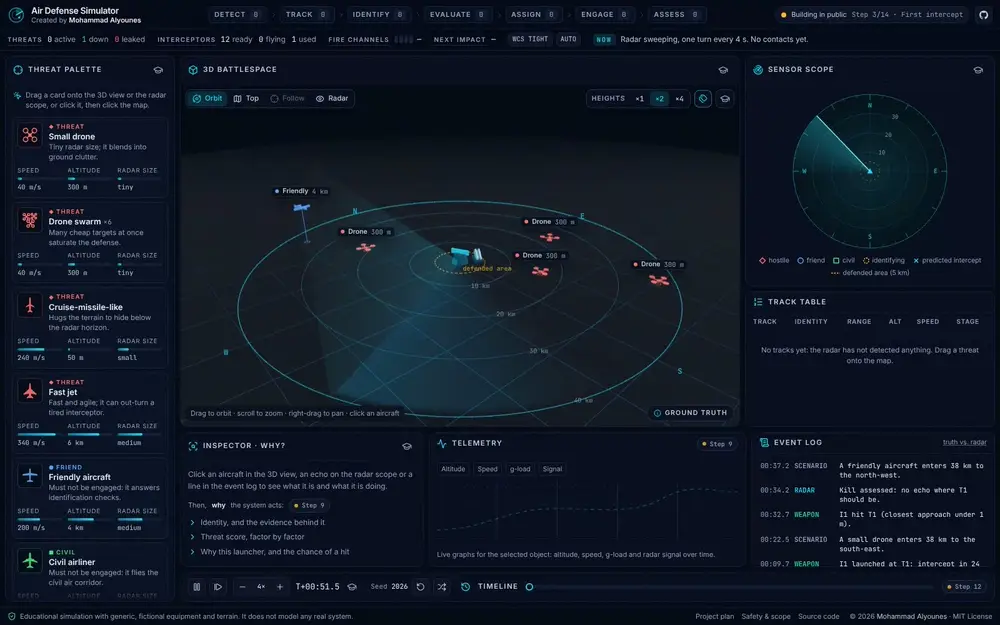</p>

The first full defense loop. Drag a threat onto the map and watch the battery detect, track, identify, evaluate, assign, engage and assess it, with every stage counted live in the header.

- **Drag-and-drop threats:** drag a palette card onto the 3D view or the radar scope (or click a card, then the map; or press Enter twice). A ghost shows its route to the battery, how long it will take and when the radar will first see it; the mouse wheel sets its altitude.
- **Detection range by radar size:** small objects are seen late. A drone appears at 9.5 km, a cruise-missile-like target at 17 km, a jet at 36 km.
- **The loop, version 1:** echoes become tracks; an identification check sorts friend, civil and hostile; hostiles heading for the battery are threats; the command node predicts an intercept point and fires; the radar looks again to confirm the kill, or the battery fires again.
- **Interceptors:** boost, coast and steer by proportional navigation, with a 30 g limit, computed in 2 ms steps with an exact closest approach. Friendly and civil aircraft are never engaged.
- **Live analysis bar:** a count for each stage (the chips pulse as tracks move on), threats active, down and leaked, interceptors ready, flying and used, the next impact, and a NOW line that narrates the engagement.
- **Everywhere else:** track symbols, interceptors and predicted intercept points on the scope; a live track table; launcher, interceptor trails and intercept rings in 3D; the inspector shows what the battery knows and does about the selected aircraft; result cards after each kill.

> **Engineering note: perception drives decisions.** The command node only ever uses its tracks: positions and velocities estimated from radar echoes, never the hidden truth. The truth is used where the physics needs it (the interceptor meets the real target) and to reveal, after the fact, what a target really was. That separation is what Steps 4 and 5 build on, when noise makes perception imperfect.

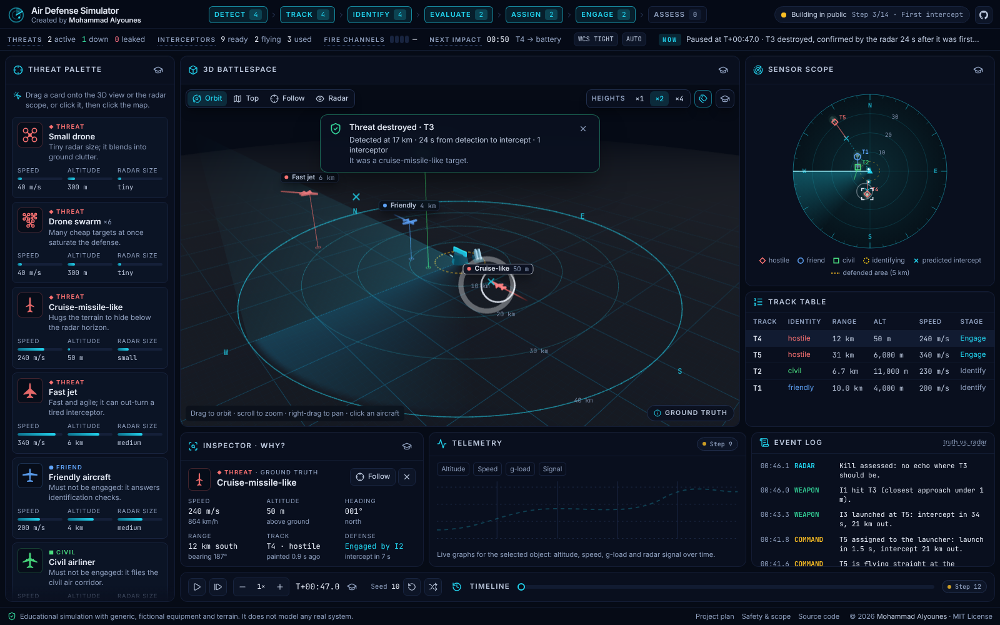

<details>
<summary>Phone layout</summary>
<br />
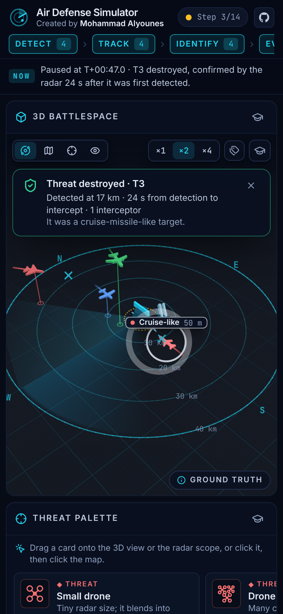
</details>

### Step 2 · 3D scene

<p align="center">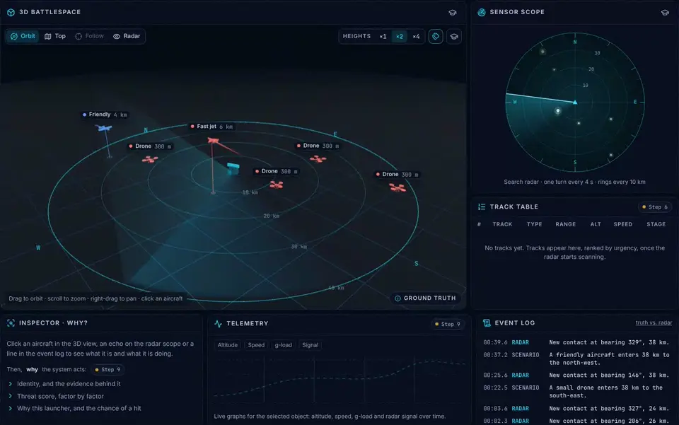</p>

The battlespace in 3D, in step with the radar scope: select an aircraft in one view and every view follows.

- **3D battlespace:** ground grid, range rings every 10 km, and the radar site with its turning antenna, search beam and sweep, all driven by the same simulation as the scope.
- **Aircraft:** models built from the palette silhouettes, each with a drop line to the ground, a fading 30-second trail and a tag showing its true altitude.
- **Cameras:** Orbit, Top (north up, like the scope), Follow and Radar (stand at the antenna and look out), on keys 1–4. Stretch heights ×1, ×2 or ×4; toggle labels with L.
- **One selection everywhere:** click an aircraft in 3D, an echo on the scope or a line in the event log. The scope boxes its echo, and the inspector shows the ground truth: speed, altitude, heading, range and what the radar knows. Esc clears it.
- **Shareable views:** [`?t=60&select=3&camera=follow`](https://mohammadalyounes.github.io/air-defense-sim/?t=60&select=3&camera=follow) opens the run one minute in, following the fast jet.

> **Engineering note: one truth, many views.** The scope, the 3D view and the inspector all read the same pair of simulation snapshots, so they can never disagree. The 3D view only draws when something changes (a paused run costs no GPU time), and three.js loads in its own chunk after the console is on screen.

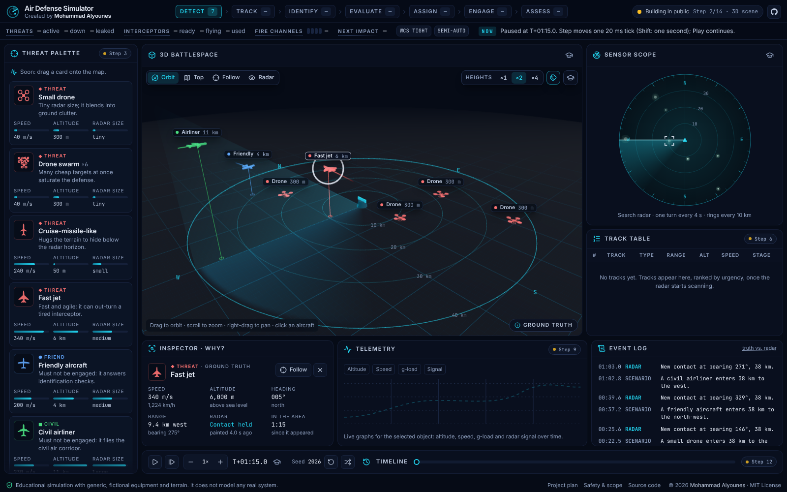

<details>
<summary>Phone layout</summary>
<br />
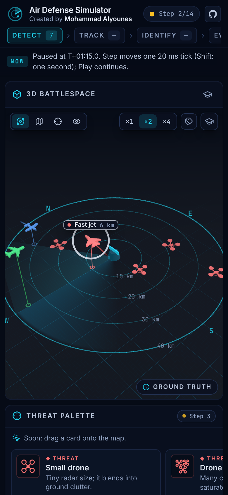
</details>

### Step 1 · Simulation core

<p align="center">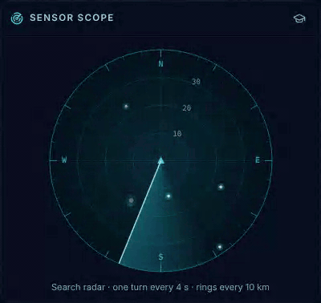</p>

The simulator comes alive: a deterministic engine running at 50 ticks per second, a live radar scope, and controls to play, pause, step and replay.

- **Simulation engine (`src/sim`):** pure TypeScript with a fixed 20 ms time step, a seeded random-number generator, scenario traffic that crosses the area, and a search radar whose rotating beam paints each aircraft as it sweeps past.
- **Live radar scope:** a sweeping beam and echoes that fade like old phosphor; bigger aircraft return bigger blips.
- **Player bar:** play/pause (Space), step one tick (.) or one second (Shift + .), speed from ¼× to 16× (+ / −), the seed, Restart (R) and New seed.
- **Live header:** the Detect stage counts radar contacts and the NOW line describes the radar picture in plain words. Stages that arrive later say which step brings them.
- **Event log:** SCENARIO lines (what really happens) next to RADAR lines (what the radar actually sees).
- **Concept cards in the app:** the graduation-cap buttons open the same cards as this README.

> **Engineering note: replay by construction.** A run is fully defined by its seed and the commands sent to it, each stamped with its tick. Unit tests rebuild runs from their command logs and compare state hashes; a browser test restarts the same seed and checks the event log matches line for line. Any moment is a link: [`?seed=7&t=60`](https://mohammadalyounes.github.io/air-defense-sim/?seed=7&t=60) opens seed 7, one minute in.

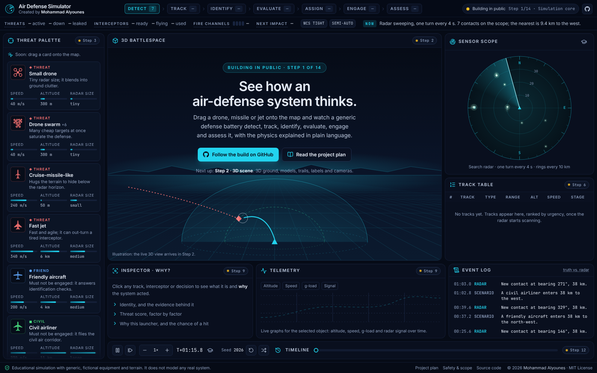

<details>
<summary>Phone layout</summary>
<br />
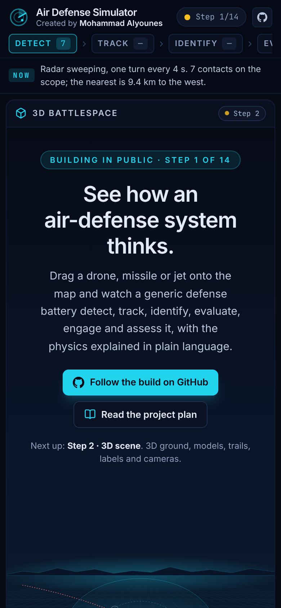
</details>

### Step 0 · Launchpad

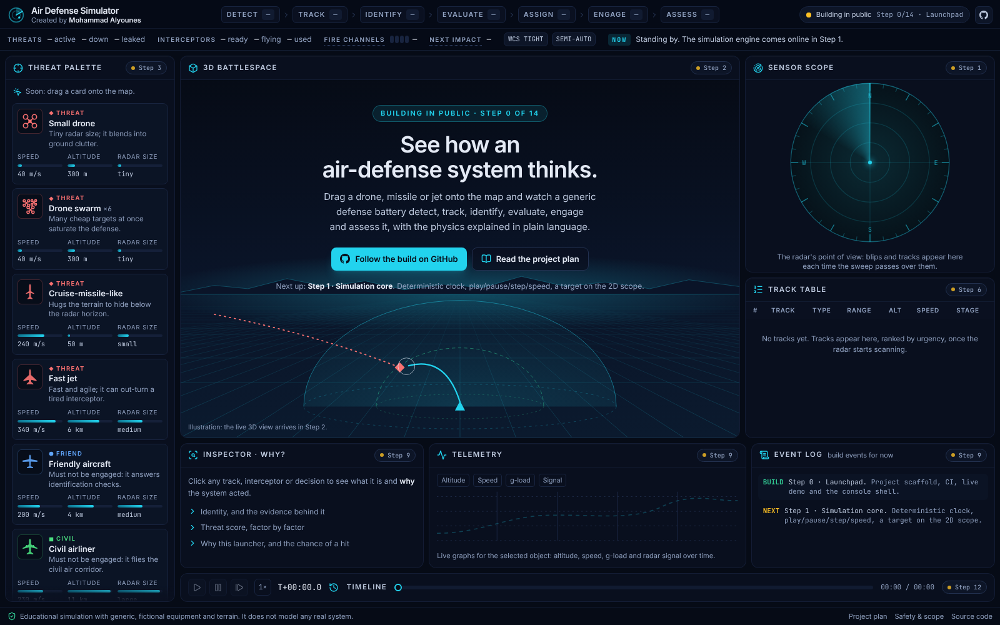

The foundation everything else builds on.

- **Console shell:** the header analysis bar (seven-stage pipeline, key numbers, plain-language "Now" line), the threat palette, an animated radar scope, and a panel for every future feature, each labelled with the step that brings it to life.
- **Tooling:** strict TypeScript, Vite 8, React 19, Tailwind CSS 4, ESLint, Prettier, Vitest and Playwright.
- **CI/CD:** every push is linted, type-checked, tested in a real browser and deployed to GitHub Pages.

> **Engineering note: determinism, enforced from day one.** The simulation core (`src/sim`) is not allowed to call `Math.random()`, read the wall clock or touch browser APIs, and the linter rejects any attempt. Same inputs, same outputs, every time: that is what will make exact replays, "rewind and try again" and Monte Carlo runs possible.

<details>
<summary>Phone layout</summary>
<br />
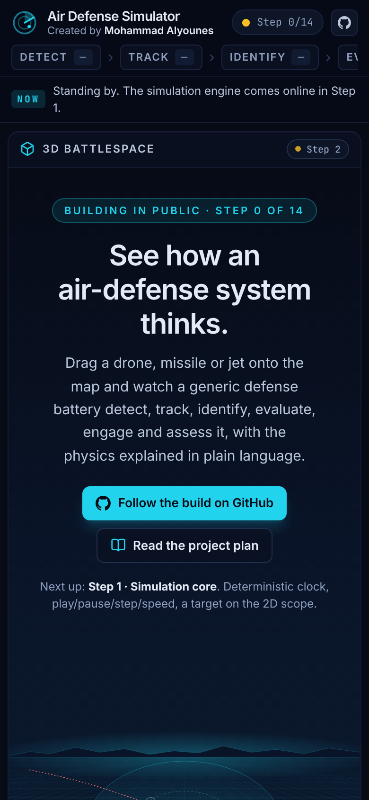
</details>

## Roadmap

- [x] **Step 0 · Launchpad:** project scaffold, CI, live demo and the console shell
- [x] **Step 1 · Simulation core:** deterministic clock, play/pause/step/speed, live radar scope
- [x] **Step 2 · 3D scene:** 3D ground, models, trails, labels and cameras
- [x] **Step 3 · First intercept:** the first full loop, drag-and-drop threats and the live analysis bar
- [ ] **Step 4 · Environment & radar:** terrain, atmosphere, wind and drag, threat routes; radar equation, noise, horizon, terrain masking, clutter and coverage maps
  - In: terrain, terrain following, drag, detection probability, noise, false alarms, horizon, masking and the coverage map
  - Still to come: wind, threat routes and evasive turns, the standard atmosphere, clutter and Doppler
- [ ] **Step 5 · Track & identify:** Kalman tracking, uncertainty ellipses, truth vs. perception; identification, civil traffic, defended assets, threat ranking with "Why?"
  - In: Kalman tracking, gating and association, uncertainty ellipses, track quality, truth vs. perception
  - Still to come: identification mistakes, the classifier, air corridors, defended assets and threat ranking with "Why?"
- [ ] **Step 6 · Engage & assess:** fire channels, engagement envelopes, kill probability, doctrine and operator approval; kill assessment, saturation, telemetry and the full analysis bar
- [ ] **Step 7 · Scenarios & replay:** save, load and share, editor and raid generator; timeline scrubbing, rewind and branch, Monte Carlo, CSV export
- [ ] **Step 8 · Learning layer:** ten guided lessons, live equations, challenges, after-action review
- [ ] **Step 9 · Polish & release v1.0:** cinematic intro, effects, sound, themes, accessibility, demo video and the v1.0 release

The full specification is in [docs/PROJECT_PLAN.md](docs/PROJECT_PLAN.md).

## Under the hood

| Layer      | Choice                                                                 |
| ---------- | ---------------------------------------------------------------------- |
| Language   | TypeScript (strict)                                                    |
| App        | React 19, Vite 8                                                       |
| 3D         | Three.js with React Three Fiber, loaded on demand                      |
| Styling    | Tailwind CSS 4, Radix UI, Lucide icons                                 |
| Simulation | Plain TypeScript: fixed time step, seeded randomness, Web Worker ready |
| App state  | Zustand                                                                |
| Tests      | Vitest (unit), Playwright (browser)                                    |
| CI/CD      | GitHub Actions → GitHub Pages                                          |

```
src/
  sim/      The engine: pure, deterministic TypeScript (clock, traffic, radar, tracks, command node, interceptors)
  app/      React UI: analysis bar, palette, radar scope, 3D view, panels and the simulation driver
e2e/        Browser tests
docs/       Plan, architecture, models, devlog, concept cards and media
scripts/    Docs sync, screenshots, GIFs and preview images
```

| Command             | What it does                                            |
| ------------------- | ------------------------------------------------------- |
| `npm run dev`       | Start the dev server                                    |
| `npm run build`     | Production build into `dist/`                           |
| `npm test`          | Unit tests                                              |
| `npm run test:e2e`  | Browser tests                                           |
| `npm run check`     | Lint, type-check, unit tests, format and docs checks    |
| `npm run docs:sync` | Copy the concept cards from `docs/concepts` into README |

More detail in [docs/ARCHITECTURE.md](docs/ARCHITECTURE.md) (how it fits together) and [docs/MODELS.md](docs/MODELS.md) (every equation and its limits).

## Safety and scope

This is a learning tool, not a model of any real system. Equipment and terrain are fictional, parameters are illustrative, and the physics stays at textbook level. Community scenarios must follow the same rules: read [SAFETY.md](SAFETY.md).

## Built with Claude

This project is being built in public, step by step, with [Claude Code](https://claude.com/claude-code). The rules Claude follows in this repository are in [CLAUDE.md](CLAUDE.md), and every step's decisions are logged in [docs/DEVLOG.md](docs/DEVLOG.md).

Created by [Mohammad Alyounes](https://github.com/MohammadAlyounes). Contributions are welcome: see [CONTRIBUTING.md](CONTRIBUTING.md).

## License

Code: [MIT](LICENSE). Documentation, lessons and concept cards: [CC BY 4.0](LICENSE-docs.md).

If you share, fork or build on this project, please keep the credit "Created by Mohammad Alyounes" (see [NOTICE](NOTICE)). To cite it, use the **Cite this repository** button on GitHub ([CITATION.cff](CITATION.cff)).
