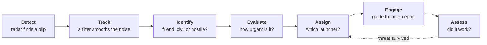

<div align="center">

<a href="https://mohammadalyounes.github.io/air-defense-sim/"></a>

# Air Defense Simulator

**See how an air-defense system thinks.**<br />
Drag a drone, missile or jet onto the map and watch a generic defense battery detect, track, identify, evaluate, engage and assess it, with the physics explained in plain language.

[**Live demo**](https://mohammadalyounes.github.io/air-defense-sim/) · [**Run it locally**](#quick-start) · [**Follow the build**](#build-log) · [**Project plan**](docs/PROJECT_PLAN.md)

[](https://github.com/MohammadAlyounes/air-defense-sim/actions/workflows/ci.yml)


[](LICENSE)


</div>

> [!NOTE]
> **Educational and generic.** Every radar, launcher and interceptor in this project is fictional, with round-number parameters chosen for teaching. The physics is textbook-level and the terrain is procedurally generated. See [SAFETY.md](SAFETY.md).

## What you'll be able to do

- **Drag threats onto the map.** Small drones, drone swarms, cruise-missile-like targets and fast jets, plus friendly and civil aircraft that must _not_ be engaged.
- **Watch the whole defense loop.** A live analysis bar follows every track through **Detect → Track → Identify → Evaluate → Assign → Engage → Assess**, with a plain-language "Now" line.
- **Ask "Why?"** Click any decision to see the reasoning: the evidence, the threat score, the intercept geometry and the chance of a hit.
- **See the physics, not magic.** Radar horizon, terrain masking, Kalman filtering and proportional navigation, each explained in three sentences and one formula.
- **Experiment.** Tune parameters, save and share scenarios, rewind and try a different decision, or run a scenario hundreds of times to see the odds.

## Quick start

You need [Node.js 22 or newer](https://nodejs.org/).

```bash
git clone https://github.com/MohammadAlyounes/air-defense-sim.git
cd air-defense-sim
npm install
npm run dev
```

Then open http://localhost:5173 in your browser.

Nothing to install? Run it in the cloud with one click:

[](https://codespaces.new/MohammadAlyounes/air-defense-sim)

## How it works: the defense loop



| Stage        | In one sentence                                                                                       |
| ------------ | ----------------------------------------------------------------------------------------------------- |
| **Detect**   | The search radar scans the sky; any echo strong enough to stand out from the noise becomes a blip.    |
| **Track**    | Blips from successive scans are linked into a track, and a filter estimates position and velocity.    |
| **Identify** | Speed and altitude suggest the type; an identification check separates friend, civil and hostile.     |
| **Evaluate** | Threats are ranked by how soon, and how close, they will reach a defended asset.                      |
| **Assign**   | The system checks range, free radar channels and ammunition, then picks a launcher.                   |
| **Engage**   | The interceptor flies toward a predicted intercept point, then homes in with proportional navigation. |
| **Assess**   | The radar watches what happens next; if the threat survived, the loop goes again.                     |

## The physics, in plain language

Each step adds short concept cards here: what the idea is, one formula, one worked example, and where to see it in the simulator. The first cards arrive with:

- **Step 1:** fixed time steps and determinism (why every run can be replayed exactly)
- **Step 3:** detection range and proportional navigation
- **Step 4:** air density, drag and turn radius
- **Step 5:** the radar equation, the radar horizon and terrain masking

## Build log

Every step is a git tag, so you can check out any stage of the project, for example `git checkout step-00-launchpad`.

### Step 0 · Launchpad


The foundation everything else builds on.

- **Console shell:** the header analysis bar (seven-stage pipeline, key numbers, plain-language "Now" line), the threat palette, an animated radar scope, and a panel for every future feature, each labelled with the step that brings it to life.
- **Tooling:** strict TypeScript, Vite 8, React 19, Tailwind CSS 4, ESLint, Prettier, Vitest and Playwright.
- **CI/CD:** every push is linted, type-checked, tested in a real browser and deployed to GitHub Pages.

> **Engineering note: determinism, enforced from day one.** The simulation core (`src/sim`) is not allowed to call `Math.random()`, read the wall clock or touch browser APIs, and the linter rejects any attempt. Same inputs, same outputs, every time: that is what will make exact replays, "rewind and try again" and Monte Carlo runs possible.

<details>
<summary>Phone layout</summary>
<br />

</details>

## Roadmap

- [x] **Step 0 · Launchpad:** project scaffold, CI, live demo and the console shell
- [ ] **Step 1 · Simulation core:** deterministic clock, play/pause/step/speed, a target on the 2D scope
- [ ] **Step 2 · 3D scene:** 3D ground, models, trails, labels and cameras
- [ ] **Step 3 · First intercept:** the first full loop, drag-and-drop threats and the live analysis bar
- [ ] **Step 4 · Environment:** terrain, atmosphere, wind and drag; three threat types with routes
- [ ] **Step 5 · Radar realism:** radar equation, noise, horizon, terrain masking, clutter and coverage maps
- [ ] **Step 6 · Tracking:** Kalman tracking, uncertainty ellipses, track table, truth vs. perception
- [ ] **Step 7 · Identify & evaluate:** identification, friendly and civil traffic, threat ranking with "Why?"
- [ ] **Step 8 · Engage:** engagement envelopes, kill probability, doctrine and missile phases
- [ ] **Step 9 · Assess:** kill assessment and re-engagement; full analysis bar, log, telemetry, inspector
- [ ] **Step 10 · Scenarios:** save, load and share; editor and raid generator
- [ ] **Step 11 · Learning layer:** ten guided lessons, live equations, challenges, after-action review
- [ ] **Step 12 · Replay & analysis:** timeline scrubbing, rewind and branch, Monte Carlo, CSV export
- [ ] **Step 13 · Polish:** cinematic intro, effects, sound, themes, accessibility
- [ ] **Step 14 · Release v1.0:** demo video, final README and launch kit

The full specification is in [docs/PROJECT_PLAN.md](docs/PROJECT_PLAN.md).

## Under the hood

| Layer            | Choice                                                                 |
| ---------------- | ---------------------------------------------------------------------- |
| Language         | TypeScript (strict)                                                    |
| App              | React 19, Vite 8                                                       |
| 3D (from Step 2) | Three.js with React Three Fiber                                        |
| Styling          | Tailwind CSS 4, Radix UI, Lucide icons                                 |
| Simulation       | Plain TypeScript: fixed time step, seeded randomness, Web Worker ready |
| Tests            | Vitest (unit), Playwright (browser)                                    |
| CI/CD            | GitHub Actions → GitHub Pages                                          |

```
src/
  app/      React UI: analysis bar, threat palette, panels and views
  sim/      Pure, deterministic simulation core (no UI code; starts in Step 1)
e2e/        Browser tests
docs/       Plan, architecture, devlog, concept cards and media
scripts/    Screenshot and preview-image generators
```

| Command            | What it does                                  |
| ------------------ | --------------------------------------------- |
| `npm run dev`      | Start the dev server                          |
| `npm run build`    | Production build into `dist/`                 |
| `npm test`         | Unit tests                                    |
| `npm run test:e2e` | Browser tests                                 |
| `npm run check`    | Lint, type-check, unit tests and format check |

More detail in [docs/ARCHITECTURE.md](docs/ARCHITECTURE.md).

## Safety and scope

This is a learning tool, not a model of any real system. Equipment and terrain are fictional, parameters are illustrative, and the physics stays at textbook level. Community scenarios must follow the same rules: read [SAFETY.md](SAFETY.md).

## Built with Claude

This project is being built in public, step by step, with [Claude Code](https://claude.com/claude-code). The rules Claude follows in this repository are in [CLAUDE.md](CLAUDE.md), and every step's decisions are logged in [docs/DEVLOG.md](docs/DEVLOG.md).

Created by [MohammadAlyounes](https://github.com/MohammadAlyounes). Contributions are welcome: see [CONTRIBUTING.md](CONTRIBUTING.md).

## License

Code: [MIT](LICENSE). Documentation, lessons and concept cards: [CC BY 4.0](LICENSE-docs.md).
